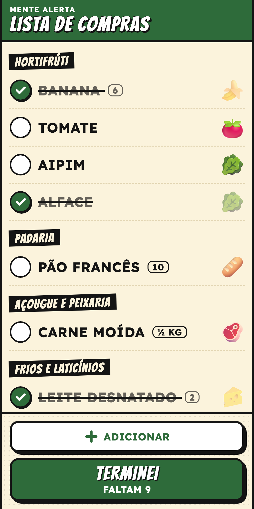
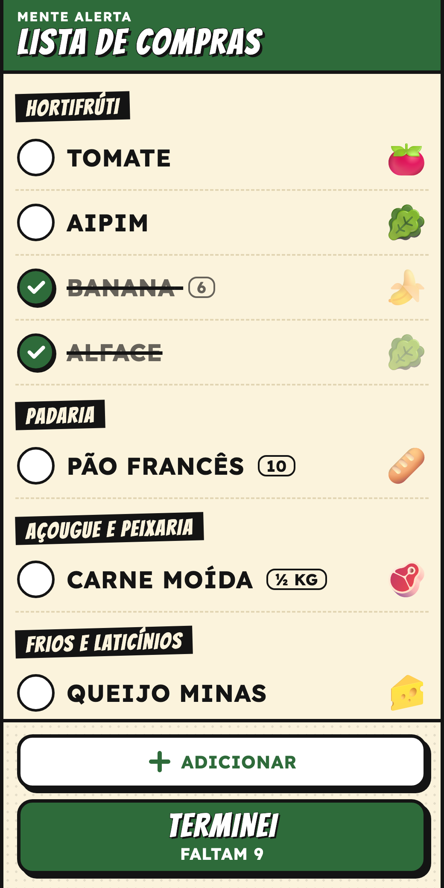

# Roteiro do teste com pessoas 60+

Teste de usabilidade da fase 0 ([plano §3.9](../plano-implementacao.md#39-validação-com-usuários-reais)), planejado na #30 em 2026-11-22. As sessões acontecem na #33 e os aprendizados viram decisões na #34.

## Objetivo

Descobrir, antes do lançamento, onde pessoas 60+ travam no app. Pontos que o plano deixou para validar:

- o gesto de passar o dedo para riscar
- o vocabulário: "Terminei", "Ops, voltar", "Jogar a lista fora", "Seção" ([guia de linguagem](../guia-de-linguagem.md))
- o tamanho da letra
- a entrada por voz
- os nomes em caixa alta e o estilo quadrinhos
- produto riscado no lugar ou no fim da seção (#32)

## Participantes

- **3 a 5 pessoas**, da família. Quem nunca viu o app.
- Todas: 60 anos ou mais, fazem compras de mercado pelo menos uma vez por mês, usam celular Android.
- Buscar a mistura (para 5 pessoas):
  - idade: pelo menos 2 com 70+ (se possível 1 com 80+)
  - celular: pelo menos 2 que usam só o básico (WhatsApp, ligação, foto) e 1 que se vira bem
  - lista hoje: pelo menos 1 que usa papel e 1 que não faz lista
  - visão: pelo menos 1 que usa óculos para ler ou deixa a letra do celular aumentada
- Região não é critério; anotar onde a pessoa cresceu para guardar as palavras regionais que ela usar.
- **Atenção:** familiares tendem a ser gentis demais. Repetir que quem está sendo testado é o app, e valorizar as críticas.

## Preparação

- O teste roda no **app de verdade** (APK de teste), **no aparelho de quem conduz** (tablet ou celular Android). Se der, fazer pelo menos uma sessão num celular: é nele que o app vai ser usado, e no tablet a letra fica maior e o gesto de passar o dedo é mais longo. Anotar o aparelho no modelo.
- Antes de cada sessão, deixar a lista vazia: Configurações → Apps → Lista de Compras → Armazenamento → **Limpar dados** (ou `adb shell pm clear br.com.mentealerta.listadecompras`).
- Perguntar à pessoa (ou olhar no celular dela) o tamanho de letra que ela usa e deixar o mesmo no aparelho do teste.
- Conferir internet e microfone (a voz precisa deles).
- Ter à mão: o [modelo de anotação](modelo-sessao.md), as duas imagens da tarefa 12 (impressas ou em outra tela) e um papel com as cinco carinhas para a nota final.
- Se o aparelho do teste for um celular Motorola: conferir se o nome "Lista de Compras" aparece inteiro embaixo do ícone (ponto 5 do plano).

## Formato

- **30 a 40 minutos**: conversa inicial (5 min), tarefas (20 a 25 min), perguntas finais (5 a 10 min).
- Na casa da pessoa ou num lugar tranquilo que ela conheça. Não no mercado (o barulho atrapalha a voz e a observação).
- **Uma pessoa conduz** e anota.
- **Gravação da tela com áudio** (gravador de tela do Android), só se a pessoa aceitar. Perguntar antes: "Posso gravar a tela e a sua voz? Seu rosto não aparece." A gravação fica fora do git e é apagada depois das anotações.

## Conversa inicial

Dizer, com as próprias palavras:

> "Estou testando um app de lista de compras. Quem está sendo testado é o app, não você. Se alguma coisa ficar difícil, a culpa é do app, e é exatamente isso que eu quero descobrir. Se puder, vá falando o que está pensando enquanto usa."

Depois, pedir que a pessoa digite umas palavras no WhatsApp ou num app de notas do aparelho do teste, para se acostumar com o teclado.

Anotar no modelo: faixa de idade, onde cresceu, uso do celular, se faz lista hoje, óculos ou letra aumentada.

## Regras para quem conduz

- **Não ajudar nem explicar** durante a tarefa. Se a pessoa pedir ajuda, devolver: "O que você tentaria?"
- Ajudar só se ela estiver travada **há mais de 1 minuto** ou pedir **duas vezes**. Anotar como "com ajuda".
- Nunca dizer "está errado".
- Não pedir que fale em voz alta com insistência; é normal ficar calada quando se concentra.
- Contar a situação da tarefa **sem usar as palavras do app** (não dizer "risque", "Terminei", "Ops, voltar").
- Se uma tarefa falhar, deixar o app no ponto certo e seguir para a próxima.

## Tarefas

A sessão começa com a lista vazia. As tarefas seguem a vida real: montar a lista, ir ao mercado, terminar.

| # | O que dizer | O que observar |
|---|---|---|
| 1 | "Sem tocar em nada: o que você acha que é esta tela? O que dá para fazer nela?" | Primeira impressão, letra, caixa alta, estilo quadrinhos |
| 2 | "Acabou o arroz em casa. Coloque arroz na lista." | Acha o "Adicionar"? Digita bem? Usa a busca enquanto digita? |
| 3 | "Coloque também 2 litros de leite, só que desnatado." | Escreve tudo junto? Quantidade e detalhe saem certos? |
| 4 | "Agora, sem digitar: coloque feijão, café e uma dúzia de ovos." | Acha o "Falar"? Entende o aviso do microfone (só aparece na primeira vez)? Fala tudo de uma vez ou um por um? Sabe parar ("Terminei")? O app entendeu? O que fez quando errou? |
| 5 | "Você lembrou que precisa de leite e foi colocar de novo." | Entende a pergunta "Leite já está na lista. Quer mais um?" |
| 6 | "Mudou de ideia: são 3 litros de leite, não 2." | Toca no produto para editar? Usa o − / +? |
| 7 | "O café não precisa mais. Tire da lista." | Acha o "Tirar da lista" na edição? |
| 8 | "Ih, era engano, você precisa do café sim." | Vê o aviso e toca em "Ops, voltar" antes de sumir (15 s)? |
| 9 | "Agora você está no mercado. Já pegou o arroz e o feijão." | Toca ou passa o dedo? Se só tocar, pedir depois: "Tente de outro jeito." O gesto funciona de primeira? |
| 10 | "Pronto, você pagou e chegou em casa. O que faria com a lista agora?" | Acha o "Terminei"? Entende o "Faltam N"? Entende o que aconteceu com o que não foi riscado? |
| 11 | "Você quer começar uma lista do zero." | Acha o "Jogar a lista fora"? Entende a confirmação? |
| 12 | Mostrar as duas imagens: "Em qual fica mais fácil ver o que falta pegar?" | Escolha e o porquê (#32) |

**Tarefa 12:** alternar entre os participantes qual imagem aparece primeiro (P1, P3, P5 começam pela "no lugar"; P2 e P4 pela "no fim") e anotar.

| No lugar (como no papel) | No fim da seção |
|---|---|
|  |  |

**Se o tempo apertar,** a tarefa 11 é a primeira a sair.

**Fora do teste:** compartilhar pelo WhatsApp e sugestões do histórico (ainda não existem no app).

## O que observar

Em cada tarefa, uma linha no modelo:

- **Resultado:** ✅ sozinha · 🟡 com ajuda · ❌ não conseguiu
- **Hesitação:** ficou mais de 10 s parada sem saber o que fazer?
- **Caminho:** o que tocou primeiro, se diferente do esperado
- **Falas:** frases exatas, entre aspas

Não medir tempo durante a sessão; se precisar, tirar da gravação.

Durante toda a sessão:

- **Letra:** aproxima ou afasta o aparelho, aperta os olhos, pede os óculos
- **Toques** errados ou fora do botão
- **Passar o dedo:** tenta sozinha? Funciona de primeira?
- **Voz:** fala natural ou pausada? O app entendeu? O que fez quando errou?
- **Palavras próprias:** as que a pessoa usa no lugar das do app (ex.: "apagar" em vez de "tirar da lista")

## Perguntas finais

Em conversa, sem pressa:

1. "O que achou mais fácil? E o mais difícil?"
2. Apontar e perguntar "O que você acha que acontece se tocar aqui?" em **Terminei**, **Ops, voltar** e **Jogar a lista fora**; e "O que quer dizer isso?" no título de uma **Seção**.
3. "A letra está boa, pequena ou grande?" e "Os nomes em letra maiúscula ficam fáceis de ler?"
4. "O que achou dos desenhos e das cores?"
5. "Você usaria isso no lugar do seu jeito de hoje? Por quê?"
6. Mostrar as cinco carinhas: **"De 1 a 5, quanto foi fácil usar?"**

Agradecer. Uma lembrança simples (um café, um chocolate) é opcional.

## Depois da sessão

- Passar as anotações para `docs/teste-usuarios/sessao-N.md`, a partir do [modelo](modelo-sessao.md).
- Nas anotações, **nunca o nome**: "Participante 1" (P1), idade em faixa (60–69, 70–79, 80+).
- Apagar a gravação depois de anotar. Gravação nunca vai para o git.
- Limpar os dados do app antes da próxima sessão.

## Como ler o resultado (#34)

- ❌ ou 🟡 em **2 ou mais pessoas** na mesma tarefa: problema a corrigir antes do lançamento.
- Só 1 pessoa: anotar e ficar de olho.
- Palavra entendida errado por **2 ou mais**: rever no guia de linguagem.
- Tarefa 12: a variante preferida pela maioria decide a #32, a não ser que a observação da tarefa 9 mostre o contrário.
